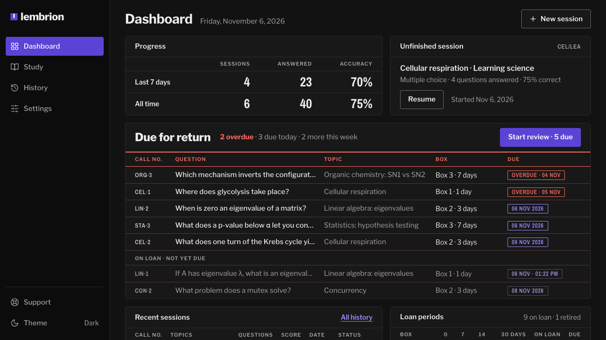

# lembrion 🎓

**AI study sessions built on learning science, using the AI provider you choose**

lembrion turns a list of study topics into a quiz session. An AI model writes multiple-choice or open-ended questions, evaluates your written answers, and keeps a history of every session. The approach is inspired by *Make It Stick: The Science of Successful Learning*.

lembrion is a client-only web app: there is no backend and no account. Your browser calls the AI provider directly with your own API key.

lembrion is based on [Studorama](https://github.com/oluiscabral/studorama) by oluiscabral (MIT).

🌐 **Live at: [lembrion.vercel.app](https://lembrion.vercel.app)**



## ✨ Features

### 📚 Study sessions
- **Multiple-choice questions** with four options and an explanation, graded in the browser.
- **Dissertative (open-ended) questions**, evaluated by the AI model with written feedback and a 0-100 score; 70 or more counts as correct.
- **Mixed mode**: each new question is randomly multiple-choice or dissertative.
- **Study contexts and instructions**: list the topics to cover and optional instructions (a textbook, an author, a focus area) for the question generator.
- **Difficulty**: pick easy, medium, or hard when you start a session.
- **Confidence rating** recorded with each answer.

### 🧠 Learning techniques
Each session stores five toggles. They are on by default and can be changed when the session starts or later from the history page.
- **Spaced repetition**: a missed question, or a correct one answered with confidence 2 or less, comes back with its options reshuffled after 3 new questions, up to 2 times. It also enters a review queue across sessions: the Dashboard's "Due for return" slip lists the queued questions with their due dates and starts a review session of up to 20 due questions, and each answer moves the question between Leitner boxes due after 1, 3, 7, 14 and 30 days (a confident correct answer moves it up, a miss sends it back to the first box, and passing the last box retires it).
- **Interleaving**: with 2 or more contexts, each new question focuses on the next context in turn.
- **Elaborative interrogation**: a wrong answer triggers a follow-up "why" question; your answer is saved.
- **Self-explanation**: after a correct answer (or any answer when elaborative interrogation is off), you explain in your own words why the correct answer is right; the text is saved. "Get feedback" asks the AI what your explanation gets right and what it misses; the feedback is saved with it and does not change your score.
- **Desirable difficulties**: the difficulty goes up after 3 correct answers in a row at the current level and down after 2 misses in a row.

### 📊 History
- Dashboard with your progress (sessions, answered questions and accuracy, for the last 7 days and all time), unfinished sessions, the questions due for review, recent sessions, and how many questions each review box holds.
- Session history with search and a status filter (active / completed).
- Per-session detail view with every question, your answer, the feedback, the difficulty, the dissertative score, review copies, and your elaborative and self-explanation answers with the explanation feedback. Review sessions carry a "Review" label.
- Edit a session's contexts, instructions, difficulty, and learning settings.

### 🤖 AI providers
| Provider | API key | Default model | Notes |
|----------|---------|---------------|-------|
| **OpenAI** | Required | `gpt-6-luna` | Responses API; reasoning effort low by default |
| **Google Gemini** | Required | `gemini-3.5-flash-lite` | Thinking level low by default; the key is sent in the `x-goog-api-key` header |
| **Anthropic** | Required | `claude-haiku-5-5` | Messages API; effort low by default; use a key scoped to a workspace |
| **DeepSeek** | Required | `deepseek-flash` | Thinking off by default |
| **Messages API server** | Optional | none | Any server that speaks the Anthropic Messages API; see [Custom endpoints](#custom-endpoints) |
| **Responses API server** | Optional | none | Any server that speaks the OpenAI Responses API; see [Custom endpoints](#custom-endpoints) |

- **Model ids are free-form**: Settings suggests current models for each hosted provider, but you can enter any model id the provider accepts.
- Each provider keeps its own API key, model, reasoning effort, and (for the two server providers) base URL.
- **Reasoning effort** is set per provider in Settings, from the levels that provider offers (for example Off, Low, Medium, High, Extra high and Max for OpenAI). The default is low, or off for DeepSeek: quiz questions and grading need little reasoning. Higher levels are slower and cost more, and lembrion raises the output limit with the level (up to 64,000 tokens), because reasoning tokens count against it. Not every model accepts every level; a model that rejects one returns an error that names it.

### 🎨 Interface
- English and Portuguese (Brazil). Prompts are written per language, so questions come back in the selected language.
- Dark (the default), light, and high-contrast themes, plus a System option that follows your device. Every theme meets WCAG AA text contrast.
- Responsive layout for phones, tablets, and desktops.
- Questions and feedback are rendered as Markdown with code highlighting; LaTeX-style math is converted to readable text.

## 🔒 Privacy and costs

- **Stored in your browser**: API keys, provider settings, preferences, and study sessions live in `localStorage`. lembrion has no server, no account system, and no analytics.
- **Sent to your AI provider**: to generate and evaluate questions, your browser sends your study topics, instructions, answers, and API key to the provider you selected. The provider processes them under its own terms. With a model server on your own machine, requests stay there.
- **API keys in URLs**: you can pre-configure a provider with URL parameters (see below). A key in a URL can end up in browser history, bookmarks, or shared links, so treat such links as secrets. The app removes the parameters from the address bar after reading them.
- **Costs**: lembrion is free and open source. Cloud providers bill API usage to your key. A model on your own server has no per-request fee.
- **Delete everything**: Settings → Data removes all lembrion data from the browser.

## 🌟 Getting started

### Use the hosted app
1. Open [lembrion.vercel.app](https://lembrion.vercel.app).
2. In **Settings**, pick a provider, paste your API key, and enter or pick a model id. For your own server, enter its base URL first; the key is optional.
3. Choose your language.
4. Go to **Study**, enter one or more topics, choose the question type, and start.

### Configure a provider from the URL
```
https://lembrion.vercel.app/?provider=openai&apikey=sk-...&model=gpt-6-luna
```
Supported parameters: `provider`, `apikey` (or `api_key`, `key`), `model`, `baseUrl` (or `base_url`). Without `provider`, the app guesses it from the key format (`sk-ant-` → Anthropic, `sk-` → OpenAI, `AQ.` or `AIza` → Gemini). DeepSeek keys also start with `sk-`, so pass `provider=deepseek` for them. The server providers are `custom-messages` and `custom-responses`.

### Get an API key
- **OpenAI**: platform.openai.com → API keys
- **Google Gemini**: aistudio.google.com → API keys. Keys created since May 2026 start with `AQ.`; an older `AIza` key must be restricted to the Gemini API in AI Studio.
- **Anthropic**: platform.claude.com → Settings → API keys. Scope the key to a workspace; an unscoped key needs a workspace header that lembrion does not send.
- **DeepSeek**: platform.deepseek.com → API keys (the account needs a prepaid balance)

### Custom endpoints
Two providers connect lembrion to a server, gateway, or proxy that you choose:

| Provider | Request |
|----------|---------|
| **Messages API server** | `POST {base URL}/messages`, Anthropic Messages API format |
| **Responses API server** | `POST {base URL}/responses`, OpenAI Responses API format |

- The base URL usually ends in `/v1`. A full endpoint URL (ending in `/messages` or `/responses`) also works.
- An API key, if you enter one, is sent as `Authorization: Bearer <key>`. lembrion sends no `x-api-key` or `anthropic-*` header, because Ollama's and OpenRouter's CORS checks reject them.
- Requests are stateless (`store: false` on the Responses API) and carry no temperature. At the default effort, **Server default**, they carry no reasoning setting either, so the server's model defaults apply. Off sends `thinking: {"type": "disabled"}` (Messages) or `reasoning: {"effort": "none"}` (Responses); Low, Medium and High send `output_config.effort` or `reasoning.effort`. The output limit is 16,000 tokens at every level, which leaves room for models that think before answering. Reasoning that a server returns inline as `<think>…</think>` is removed from the answer.
- The browser calls the server directly, so the server must allow the page's origin (`https://lembrion.vercel.app`, or `http://localhost:5173` for the dev server).

| Server | Base URL | Browser access |
|--------|----------|----------------|
| Ollama 0.14+ (Messages), 0.13.3+ (Responses) | `http://localhost:11434/v1` | Pages served from localhost are allowed. For the hosted app, set `OLLAMA_ORIGINS` (below). |
| vLLM 0.32+ | `http://localhost:8000/v1` | CORS is off by default: start with `--allowed-origins '["https://lembrion.vercel.app"]'`. vLLM reads keys only from `Authorization`. |
| llama.cpp `llama-server` | `http://localhost:9931/v1` | CORS is on. With `--api-key`, also pass `--cors-headers "Authorization, Content-Type"`: the default `*` does not cover `Authorization`. |
| LM Studio | `http://localhost:1234/v1` | Turn on **Enable CORS** in the server settings, or run `lms server start --cors`. |
| LiteLLM proxy | `http://localhost:4000/v1` | CORS is open by default. The proxy requires a key. |
| OpenRouter | `https://openrouter.ai/api/v1` | Works from the browser with an OpenRouter key. Its Responses API is in beta. |

Ollama example:
```bash
# Install Ollama 0.14 or later from https://ollama.com/download, then pull a model
ollama pull gpt-oss:20b

# Allow the hosted app's origin and start the server. With the macOS app, run
# launchctl setenv OLLAMA_ORIGINS "https://lembrion.vercel.app" and restart Ollama instead.
OLLAMA_ORIGINS="https://lembrion.vercel.app" ollama serve
```
Then pick **Responses API server** (or **Messages API server**) in Settings, enter `http://localhost:11434/v1` and the model id `gpt-oss:20b`, and leave the key empty.

## 🛠️ Development

Requires Node.js 18.18 or later and npm.

```bash
git clone https://github.com/gustavokch/lembrion.git
cd lembrion
npm install

npm run dev         # Vite dev server on http://localhost:5173
npm run typecheck   # tsc -b
npm run test        # Vitest (jsdom)
npm run lint        # ESLint
npm run build       # tsc -b, then vite build into dist/
npm run preview     # serve dist/ on http://localhost:4173
```

The service worker registers only in production builds served from a non-localhost host. The dev server and local previews unregister any leftover worker.

### Technology
- React 18 + TypeScript, built with Vite 5
- Tailwind CSS 3 with semantic colour tokens (CSS variables written by the theme hook)
- Libre Franklin and Archivo Narrow, self-hosted through Fontsource
- React Router 6
- State in React hooks persisted to `localStorage` (no state library)
- AI providers called with `fetch`; no SDKs, no streaming
- Custom i18n (en-US, pt-BR)

### Releases
```bash
npm run version:info     # print the current version (read-only)
npm run version:patch    # bump the version in package.json, index.html and public/sw.js
npm run deploy           # release a patch: checks, bump, commit, tag, push
```
`npm run deploy` (or `deploy:minor` / `deploy:major`) runs only on `main`. It stops on a dirty tree unless you confirm in a terminal, runs lint, typecheck and build before it bumps the version, commits only the three version files, creates an annotated `v<version>` tag, and pushes `main` and the tag to `origin`. The hosted app deploys from `main`.

## 🤝 Contributing

1. Fork the repository.
2. Create a feature branch (`git checkout -b feature/my-change`).
3. Run `npm run typecheck`, `npm run lint`, and `npm run test`.
4. Commit and open a pull request.

Useful areas: translations, accessibility, server compatibility notes, and tests.

## 📄 License

MIT. See [LICENSE](LICENSE).

## 🙏 Acknowledgments

- **Peter C. Brown, Henry L. Roediger III, Mark A. McDaniel**, authors of *Make It Stick*
- **Lucide** for the icon set
- **React** and **Tailwind CSS**

## 📞 Support

- **Issues**: [github.com/gustavokch/lembrion/issues](https://github.com/gustavokch/lembrion/issues)
- **Sponsor**: the in-app **Support** page lists the ways to support the project.
